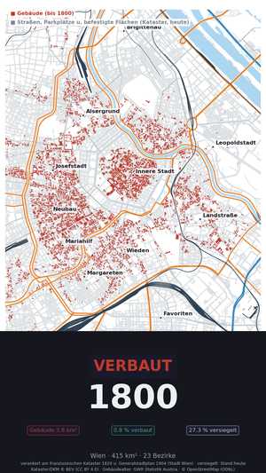
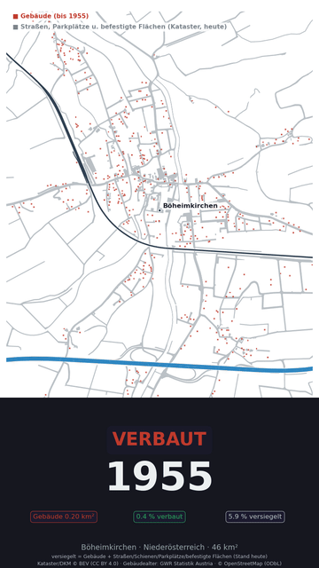

# 🏗️ Verbaut — Built-up Area Animation for Austria

> **Verbaut** (German for "built-up") animates the evolution of building footprint coverage in Austria using real OSM data. See how Vienna's built-up area grew over 70 years — from a YouTube Short to a full landscape animation.

---

## 📦 Project Structure

```
Verbaut/
├── verbaut_wien.py           ← Vienna 1800–2026 Short (9:16, per-district GWR model,
│                                archival 1829/1904 calibration)
├── historical_calibration.py ← 1829 Kataster + 1904 Generalstadtplan overlay flags
├── verbaut_short.py          ← YouTube Short generator (9:16, 1955–2026, ~30s)
├── verbaut_boeheimkirchen.py ← Böheimkirchen rural-village Short (9:16, 1955–2026)
├── verbaut_animation.py      ← Landscape animation (16:9, 2008–2026)
├── austria_bauflaeche.py     ← Original sealed-surface estimator (static analysis)
├── README.md
├── .gitignore
├── LICENSE
├── data/                     ← Cached data (*.gpkg: DKM Nutzungsflächen,
│   │                            Franziszeischer Kataster 1829, calibration flags,
│   │                            OSM districts/roads/railways/water)
│   └── gwr/                  ← Statistik Austria GWR Bauperiode CSV
├── cache/                    ← Overpass cache · Generalstadtplan 1904 WMS tiles
└── output/                   ← Generated videos, frames, reports
    ├── verbaut_vienna_10fps.mp4       ← Landscape animation
    ├── verbaut_growth.png             ← Growth chart
    ├── verbaut_report.json            ← Per-year statistics
    ├── frames/                        ← Individual frames
    └── shorts/                        ← YouTube Short output
        ├── verbaut_wien_core_226yrs.mp4           ← Vienna 1800–2026, inside the Gürtel
        ├── verbaut_wien_226yrs.mp4                ← Vienna 1800–2026, full city
        ├── verbaut_wien_70yrs.mp4     ← Vienna Short (9:16, 32s, legacy OSM model)
        ├── verbaut_boeheimkirchen_70yrs.mp4       ← full municipality
        ├── verbaut_boeheimkirchen_core_70yrs.mp4  ← village-core close-up
        ├── frames_wien/  frames_wien_core/  frames_bhmk/  frames_bhmk_core/
        └── wien_report.json  wien_core_report.json  bhmk_report.json  …
```

---

## 🎬 YouTube Short — 70 Years of Vienna

```
python verbaut_short.py
```

Output: `output/shorts/verbaut_wien_70yrs.mp4`

- **32 seconds**, 9:16 vertical (YouTube Short / TikTok / Reels)
- **72 frames** (1955 → 2026)
- Shows Vienna's building footprint growing from **34.7 km² → 58.1 km²**
- Dark green background, red built-up overlay

---

## 🏙 Vienna Demo — 226 Years of a City (1800–2026)

<p align="center">
  
</p>

▶ Videos: [inside the Gürtel](assets/verbaut_wien_core_226yrs.mp4) · [full city](assets/verbaut_wien_226yrs.mp4) · [final frame](assets/verbaut_wien_core_2026.png)

```
python verbaut_wien.py                      # full city (10 m grid)
python verbaut_wien.py --zoom-km 6 --grid 6 # inside the Gürtel
python historical_calibration.py            # optional: 1829/1904 archival anchors
```

Watching Vienna grow from Biedermeier town to Gründerzeit metropolis to
today — one frame per year, 1800 → 2026. Same cadastral geometry as the
Böheimkirchen demo (BEV DKM, all 89 Wiener Katastralgemeinden, ~209 000
building footprints), but the growth model needed three upgrades for a
city and a 226-year clock:

- **Per-district growth curves.** Statistik Austria's GWR lists Vienna as
  its 23 districts, each with its own Bauperiode distribution. Buildings
  are spatially joined to their Bezirk (OSM admin_level 9) and sampled
  against *that district's* curve — the historic core fills in first,
  trans-Danube Donaustadt last, as actually happened (share of today's
  stock standing 1918: Innere Stadt 75 %, Ottakring 31 %, Donaustadt 3 %).
- **Pre-1919 timing from historical population.** The GWR's earliest
  period is just "vor 1919". To start the clock in 1800 the pre-1919
  stock is distributed across 1800–1918 proportionally to Vienna's
  documented population (≈272 000 in 1800 → 2 083 630 at the 1910
  census, today's boundaries) — so the Gründerzeit boom of 1850–1914 is
  visible instead of a 120-year linear smear.
- **Archival calibration (1829 & 1904).** `historical_calibration.py`
  anchors the model to two monarchy-era sources published by the City of
  Vienna (CC BY 4.0): the **Franziszeischer Kataster 1829** — vectorised
  by Stadtarchäologie Wien (WFS `FRANZKATOGD`, ~28 000 building polygons
  classed Stein/Holz/Kirche/Militär/öffentlich) and overlaid directly on
  the DKM footprints (same EPSG:31256 frame) — and the
  **Generalstadtplan 1904** (WMS `GENLPLAN1904OGD`), tested per footprint
  via its interior dark-pixel fraction on 1 m/px tiles. Each building
  gets a *measured year bracket* (standing 1829 → [1800–1829], appeared
  → [1830–1904], absent 1904 → [1905–…], off-sheet → unconstrained) and
  the GWR curve is only sampled *within* that bracket. Result:
  **11 365 sites already standing in 1829, 57 164 by 1904** — the 1904
  figure exceeds the GWR's surviving pre-1919 stock (~38 000), i.e. the
  archival anchors also recover sites whose buildings were later
  replaced. QA: 1829-confirmed buildings read a median dark-fraction of
  0.32 on the 1904 plan (threshold 0.12) — the two independent sources
  agree.

**Semantics:** with calibration, red before ~1905 means "this *site* was
built by then" — a Gründerzeit replacement of an 1829 house counts as
1829. For a built-up-*area* animation this is more truthful than
surviving-building age. The DKM geometry itself is a present-day
snapshot: demolished-and-never-rebuilt structures (Glacis, Linienwall)
never appear.

| Year | Building footprint | Built-up ratio | Sites |
|------|-------------------|----------------|-------|
| **1800** | 3.8 km² | 0.9 % | 8 625 |
| **1850** | 7.5 km² | 1.8 % | 18 095 |
| **1890** | 18.5 km² | 4.5 % | 49 116 |
| **1910** | 25.0 km² | 6.0 % | 67 646 |
| **1960** | 33.4 km² | 8.1 % | 110 087 |
| **1990** | 44.4 km² | 10.7 % | 163 164 |
| **2026** | 53.5 km² | 12.9 % | 209 396 |

Today 27.3 % of Vienna is sealed (buildings + the DKM's measured
road/rail/parking/paved parcels, shown as a light-grey constant layer).
Rendering notes: footprints are burned onto the raster with `rasterio`
(earliest year wins per cell — centroid binning turns city blocks into
confetti), the Donau/Donaukanal are drawn as a static water layer, and
the zoomed cut labels the inner districts.

Data: Kataster/DKM © BEV (CC BY 4.0) · GWR © Statistik Austria ·
Franziszeischer Kataster & Generalstadtplan © Stadt Wien
(data.wien.gv.at, CC BY 4.0) · districts/roads/water © OpenStreetMap
contributors (ODbL)

---

## 🏡 Böheimkirchen Demo — 70 Years of a Rural Village

<p align="center">
  
</p>

▶ Videos: [full municipality](assets/verbaut_boeheimkirchen_70yrs.mp4) · [village core](assets/verbaut_boeheimkirchen_core_70yrs.mp4) · [final frame](assets/verbaut_boeheimkirchen_2026.png)

```
python verbaut_boeheimkirchen.py                      # full municipality (8 m grid)
python verbaut_boeheimkirchen.py --zoom-km 2.4 --grid 4   # village core close-up
```

Output: `output/shorts/verbaut_boeheimkirchen_70yrs.mp4` (full) and
`output/shorts/verbaut_boeheimkirchen_core_70yrs.mp4` (core close-up),
each **~9 seconds** (intro 1.5 s → one year per ~0.08 s → outro 2 s)

`--zoom-km` sets the view width in km around the village centre (the map
zooms; the km²/% stats still cover the whole municipality). Use a finer
`--grid` when zoomed so individual houses render crisply.

- **~9 seconds**, 9:16 vertical
- **72 frames** (1955 → 2026)
- Shows Böheimkirchen's building area growing from **0.20 km² → 0.73 km²** (0.44 % → 1.60 % of the 45.5 km² municipality)
- **Building geometry from the cadastre**: the animated buildings are the surveyed *Gebäude* Nutzungsflächen (NS 41) of the **Digitale Katastralmappe (DKM)** — the geometric counterpart of the Grundbuch — fetched per Katastralgemeinde (all 21 KGs of the municipality) from the BEV Niederösterreich snapshot via HTTP range requests (a few MB instead of the 3.3 GB state file). Kataster © BEV, CC BY 4.0, Stichtag 2026-04-01.
- Uses a **growth curve built from Statistik Austria's GWR (Gebäude- und Wohnungsregister)** — the federal building register — which counts buildings per **Bauperiode** (construction period) for Böheimkirchen. The 2025-01-01 extract is downloaded from statistik.at and cached in `data/gwr/`. The per-period counts are turned into a cumulative year-by-year curve by linear interpolation between period endpoints, so the animation follows the **documented construction history** of the municipality rather than an assumed sigmoid. The 27 buildings with unknown period are distributed proportionally.
- **White map background** with cartographic overlays (clipped to the municipal boundary):
  - 🛣️ **A1 Westautobahn** (blue) and **B1 Bundesstraße** (orange) with white casing
  - Secondary/tertiary roads in light grey
  - 🚂 **Westbahn / Neue Westbahn** railway (dark line on white casing)
  - 📍 Place-name labels: **Böheimkirchen**, **Mechters**, **Schildberg**, **Furth**
- Rendered on an **8 m grid**; each built cell is drawn with a 1-cell halo and a minimum opacity so single farmhouses stay visible at phone-screen scale
- **Sealed-surface layer** (grey, constant across frames), also from the DKM: the *measured* cadastral Nutzungsflächen for **Parkplätze (NS 42)**, **Gebäudenebenflächen/befestigt (NS 83)**, **Schienenverkehrsanlagen (NS 92)**, and **Straßenverkehrsanlagen (NS 95)** — no assumed road widths. *Betriebsflächen* (NS 63, 0.63 km²) are excluded as only partly sealed. The cadastre has no historical geometry, so the grey layer shows **today's extent in every frame**; only the buildings animate. Result: **5.9 % of the municipality is sealed today** (2.69 km² = 0.73 km² buildings + 1.96 km² roads/rail/parking/paved) vs. 1.6 % from buildings alone. For comparison, an earlier OSM-based estimate (road centerlines buffered by assumed pavement widths) gave only 2.9 % — the cadastral road parcels are nearly 3× the buffered estimate. Unpaved `track`/`path` ways are excluded unless tagged with a paved surface, and — unlike `austria_bauflaeche.py` — `landuse=residential` is not counted (at village scale it is mostly unsealed gardens; buildings are counted separately). OSM has no historical road data, so this layer shows **today's extent in every frame**; only the buildings animate. Result: **~2.9 % of the municipality is sealed today** (1.32 km² dissolved: 0.79 km² buildings + 0.65 km² roads/parking/landuse, minus overlaps) vs. 1.74 % from buildings alone.

| Year | Cumulative fraction | Building footprint | Built-up ratio |
|------|-------------------|-------------------|----------------|
| **1955** | 26 % | 0.20 km² | 0.44 % |
| **1975** | 44 % | 0.32 km² | 0.70 % |
| **1995** | 65 % | 0.47 km² | 1.04 % |
| **2015** | 90 % | 0.66 km² | 1.46 % |
| **2026** | 100 % | 0.73 km² | 1.60 % |

---

### How it works

| Step | What |
|------|------|
| **1. Load** | Building geometry: OSM footprints for Vienna (250 k), BEV DKM cadastral *Gebäude* areas for Böheimkirchen (~3.3 k); cached locally |
| **2. Date** | Assign each building a year via random sampling against the growth curve (GWR-based for Böheimkirchen, researched anchors for Vienna) |
| **3. Raster** | Rasterise all buildings onto a grid (12 m Vienna, 8 m Böheimkirchen) in a single pass (year + coverage arrays) |
| **4. Frame** | Each frame = `np.where(year_raster ≤ year, area_raster, 0)` → direct RGB compositing |
| **5. Video** | Compile 72 frames with pacing (intro 4s → middle → outro 5s) |

### Historical growth model

Vienna is a mature city — the Ringstraße was built 1860–1900, post-war reconstruction was done by the mid-1950s.

| Year | Cumulative fraction | Building footprint | Source |
|------|-------------------|-------------------|--------|
| **1955** | 60 % | 34.7 km² | Post-war city, mostly rebuilt |
| **1975** | 72 % | 41.9 km² | Suburban expansion |
| **1995** | 85 % | 49.3 km² | Infill development |
| **2015** | 95 % | 55.1 km² | Aspern Seestadt begins |
| **2026** | 100 % | 58.1 km² | Current state |

---

## 🖥️ Landscape Animation — 2008–2026

```
python verbaut_animation.py
python verbaut_animation.py --region "St. Pölten, Austria"
python verbaut_animation.py --region "Wien" --fps 12 --grid 15
```

Output: `output/verbaut_<region>_<fps>fps.mp4`

- **19 frames** (2008–2026), landscape 16:9
- Shows the rapid OSM mapping of Austrian buildings (BEV cadastre imports in 2015, 2018, 2021)

---

## 📊 Static Analysis

```
python austria_bauflaeche.py --state wien
python austria_bauflaeche.py --all-states
```

The original sealed-surface estimator analyzes **all sealed surfaces** (buildings + roads + parking + landuse). According to its analysis:

| State | Sealed area | Ratio |
|-------|-------------|-------|
| **Wien** | 194.1 km² | **46.8 %** |
| **Vorarlberg** | 146.2 km² | 5.6 % |
| **St. Pölten** | 25.4 km² | 23.4 % |

---

## 📋 Requirements

```bash
pip install osmnx geopandas matplotlib numpy shapely requests pillow rasterio
```

For video compilation: `ffmpeg` must be available on your PATH.

OSMnx downloads data from the OpenStreetMap Overpass API — an internet connection is required for the first run (data is then cached locally).

---

## 🧠 Data & Limitations

- **Building footprints only** (Vienna short & landscape animation): those animations show building coverage (14 % of Vienna), not total sealed surface (46.8 %, which includes roads, parking, etc.). The Böheimkirchen short additionally shows a grey sealed-surface layer, but as a **present-day constant** — road/parking growth over time is not animated because no historical geometry source exists for it.
- **Cadastral "sealed" is a use classification, not a pavement survey**: the DKM Nutzungsflächen classify parcels by *use*. Straßenverkehrsanlagen parcels include some gravel rural lanes (overstating sealing), while the excluded Betriebsflächen (0.63 km²) are partly paved (understating it). The 5.9 % is the cadastral *Bau- und Verkehrsfläche* share — the best available measured proxy for soil sealing at municipal scale, sitting between the OSM lower bound (2.9 %) and land-take totals.
- **Year assignment**: Individual building ages are unknown — years are statistically sampled to match the aggregate growth curve (per district for Vienna). The growth pattern looks realistic but individual buildings may be misdated. The Vienna 1829/1904 calibration pins each footprint to a *measured* bracket, but the exact year within the bracket is still sampled; pre-census population figures (1800/1830/1850) are estimates.
- **OSM completeness**: OSM building coverage in Austria is excellent (>95 % for urban areas), but small structures (sheds, garden huts) may be over-represented.
- **Raster resolution**: grid cells (12 m Vienna, 8 m Böheimkirchen) mean very small buildings (<~50 m²) may not be individually visible; the Böheimkirchen renderer dilates built cells by one cell for visibility, so red pixels slightly overstate footprint extent (the km²/% numbers are computed from the true polygon areas, not the pixels).

---

## 📄 License

**MIT** — Free to use, modify, and share.

Data from OpenStreetMap is © OpenStreetMap contributors (ODbL).

---

*Made with ❤️ for the VibeProjects community.*
